# hwgraph environment graphs: the target machine during each benchmark

The environment graphs plot what the monitoring collected **during** each benchmark: the
power, the frequencies, the IPC, the fans and the temperatures of the target machine. They
are rendered for every benchmark of every trace, unless `--no-env` is given.

- [Per host](#per-host)
  - [Reading a violin](#reading-a-violin)
  - [Benchmarks summary](#benchmarks-summary)
- [Per chassis](#per-chassis)
- [Per group](#per-group)

Related pages: [hwgraph.md](hwgraph.md) (the command line, the traces and the output tree),
[monitoring.md](monitoring.md) (where the metrics come from), [cpu-selection.md](cpu-selection.md)
(the pinned cores), [hwgraph-scaling.md](hwgraph-scaling.md) and
[hwgraph-versus.md](hwgraph-versus.md) (the performance graphs).

# Per host
For each trace, and for each benchmark of the trace, hwgraph writes
`environment/by_host/<logical_name>/<benchmark>/<metric>/`, where `<benchmark>` is the name
in the results, like `cpu_3`, and `<metric>` the kind of metric:

| Directory | Graphs | What they plot |
|---|---|---|
| `Thermal` | `Thermal` | the temperature sensors of the BMC |
| `Fans` | `<fan>`, `Fans speed_vs_Thermal`, `Fans speed_vs_PowerConsumption` | one graph per fan, with the minimum and maximum of each aggregation; and the speed of all the fans, with the temperatures or the power on a second axis |
| `PowerConsumption` | `Package power consumption`, `PDU power reporting` | the power of the CPU package, and of the [PDU](monitoring.md#pdu) outlets |
| `PowerConsumption/all_cores` | `CPU Core power consumption` | the power of every core |
| `Freq/all_cores` | `Core frequency` | the frequency of every core |
| `IPC/all_cores` | `Core IPC` | the instructions per cycle of every core |
| `Monitor` | `Polling` | the time spent by the monitoring to poll its sources |

The graphs of this page are rendered from the [reference dataset](example/README.md): the benchmark `cpu_17`, 36 stressors of `stressng cpu int128` during 120 seconds, on a server with 32 physical cores and 8 NUMA domains.

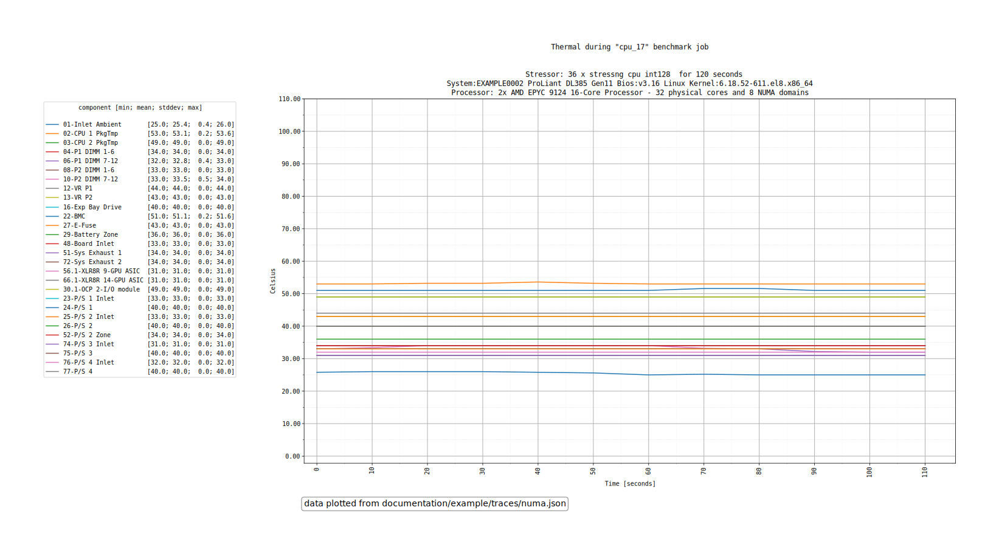

*`Thermal/Thermal.png`: the temperature sensors of the BMC during the benchmark.*

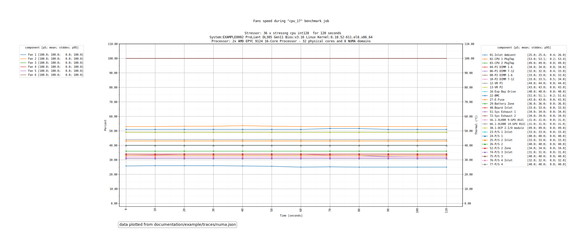

*`Fans/Fans speed_vs_Thermal.png`: the speed of the fans, with the temperatures on the second axis.*

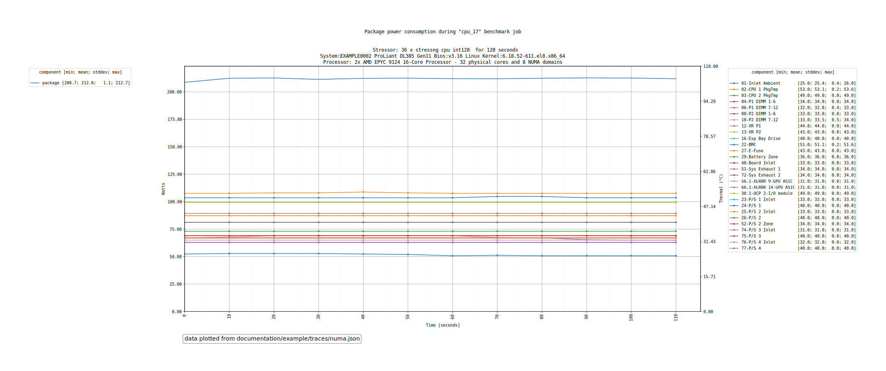

*`PowerConsumption/Package power consumption_vs_Thermal.png`: the power of the CPU package, with the temperatures on the second axis.*

The power, frequency and IPC graphs of the CPU and of the PDU exist in several variants:

| Variant | Effect |
|---|---|
| `<graph>` | the metric alone |
| `<graph>_vs_Thermal` | the metric, with the temperature sensors on a second axis |
| `<graph>_vs_PowerConsumption` | the metric, with the power consumption metrics, and the power supplies, on a second axis |

The per-core metrics (`Core frequency`, `Core IPC`, `CPU Core power consumption`) are
rendered once per view, each in its own subdirectory of the metric:

| Subdirectory | View | Exists |
|---|---|---|
| `all_cores` | every core of the target machine, one line per core | always |
| `pinned_cores` | only the cores the benchmark was [pinned](cpu-selection.md) to; the title says `View limited to the pinned logical cores [0-7, 64-71]` | for a benchmark that pinned cores |
| `all_numa` | the cores of each NUMA domain aggregated, one line per domain | when the trace has the NUMA topology |
| `pinned_numa` | the same, for the NUMA domains of the pinned cores | when the trace has the NUMA topology and the benchmark pinned cores |

A trace without the topology prints `no NUMA metric present in trace file, skipping`.

The `all_*` views observe the **whole machine**, including the cores the benchmark did not
use: they show what the idle cores do while the others are loaded. The `pinned_*` views focus
on the cores the benchmark ran on, so the idle cores do not "pollute" the graph: their low
frequency or IPC would otherwise drag down the lines, the averages and the distributions.

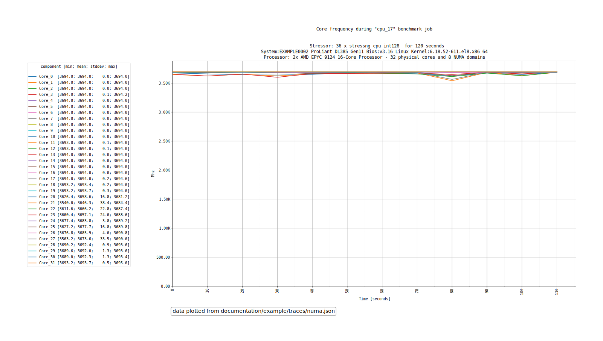

*`Freq/all_cores/Core frequency.png`: all the cores of the server. The cores used by the benchmark run at their top frequency, the others at lower and different ones.*

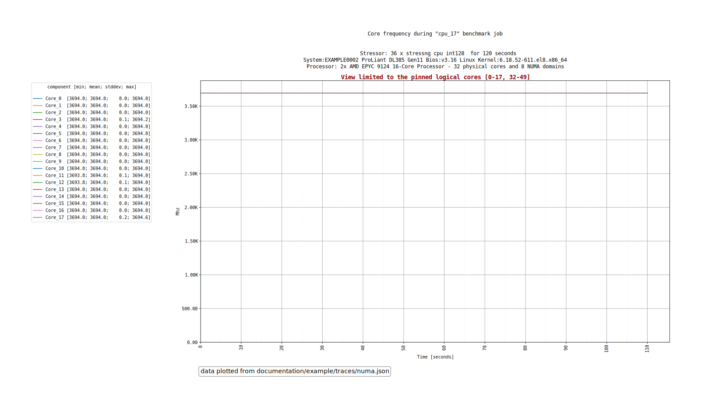

*`Freq/pinned_cores/Core frequency.png`: the same benchmark, limited to the pinned cores, named in the title.*

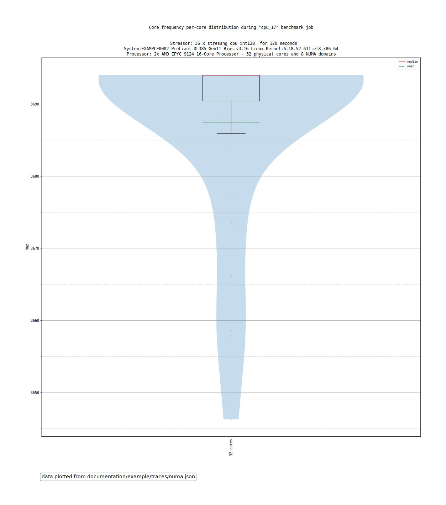

*`Freq/all_cores/Core frequency - distribution.png`: the distribution of the frequency of the cores during the benchmark.*

## Reading a violin
The `- distribution` graphs are **violin plots**: they show the **distribution of the individual results**, here one
result per core, its mean over the benchmark, instead of a single average that would hide the differences.

| Element | Meaning |
|---|---|
| the width of the violin | how many cores have a result around this value: wide where many cores are, thin where few are |
| the height of the violin | the range of the results, from the lowest core to the highest |
| the red line of the box | the median |
| the green dashed line of the box | the mean |
| the box, and the points outside | the quartiles, and the outliers |

A short, wide violin means homogeneous cores; a tall one, or one with several bulges, means cores behaving differently, like the busy and the idle cores of the `all_cores` view. With the NUMA views, there is one violin per NUMA domain, to compare the domains with each other.

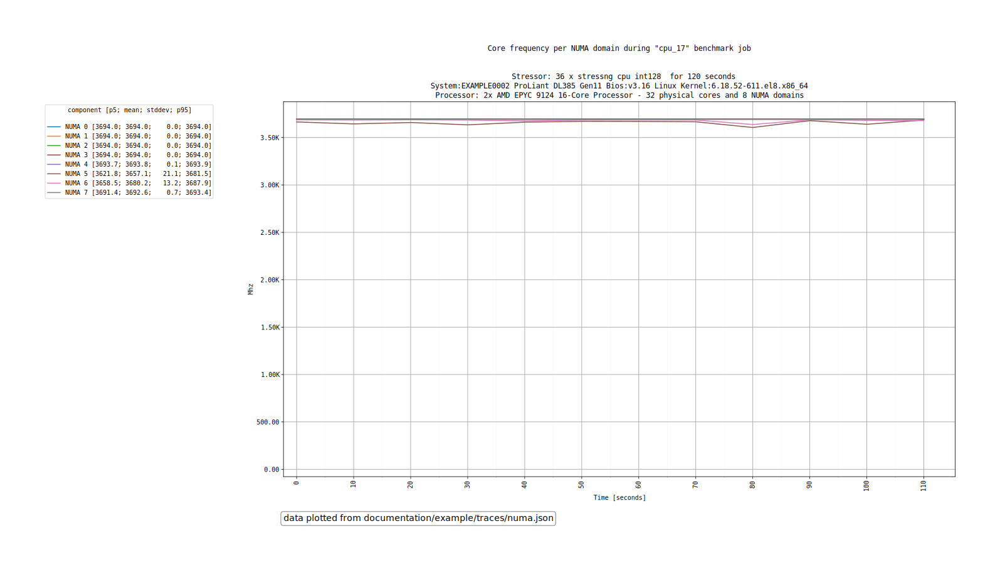

*`Freq/all_numa/Core frequency per NUMA domain.png`: one line per NUMA domain.*

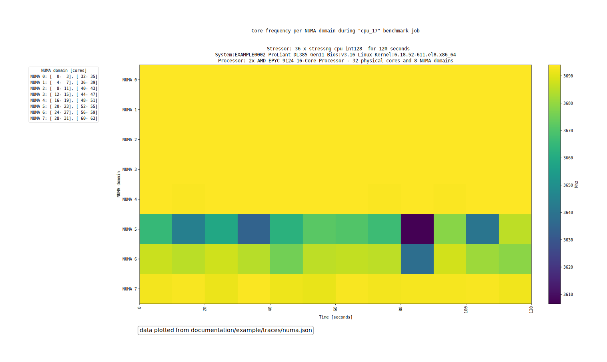

*`Freq/all_numa/Core frequency per NUMA domain - heatmap.png`: the NUMA domains over the time, colored by frequency.*

The graphs of each view:

| Graph | Views | What it plots |
|---|---|---|
| `<metric>` | `all_cores`, `pinned_cores` | one line per core over the time |
| `<metric>_vs_Thermal`, `<metric>_vs_PowerConsumption` | `all_cores`, `pinned_cores` | the same, with the temperature sensors, or the power metrics and the power supplies, on a second axis |
| `<metric> - distribution` | `all_cores`, `pinned_cores` | the distribution of the cores during the benchmark, as a violin and a box plot |
| `<metric> per NUMA domain` | `all_numa`, `pinned_numa` | one line per NUMA domain over the time: `Core frequency per NUMA domain`, `Core IPC per NUMA domain`, `CPU Core power consumption per NUMA domain` |
| `<metric> per NUMA domain - distribution` | `all_numa`, `pinned_numa` | the distribution of each NUMA domain, as a violin |
| `<metric> per NUMA domain - heatmap` | `all_numa`, `pinned_numa` | the NUMA domains over the time, colored by value; for the frequency and the IPC only |

> ℹ️ **Info**
>
> The `Polling` graphs of the BMC, the PDU and the CPU monitoring share the same file
> name: only one of them remains in `Monitor`.

Each host also gets:

| File | Content |
|---|---|
| `NUMA distances` | the distance matrix between the NUMA domains of the host, with the cores of each domain; needs the matrix of at least two domains |
| `benchmarks_summary.txt` | the [benchmarks summary](#benchmarks-summary) |

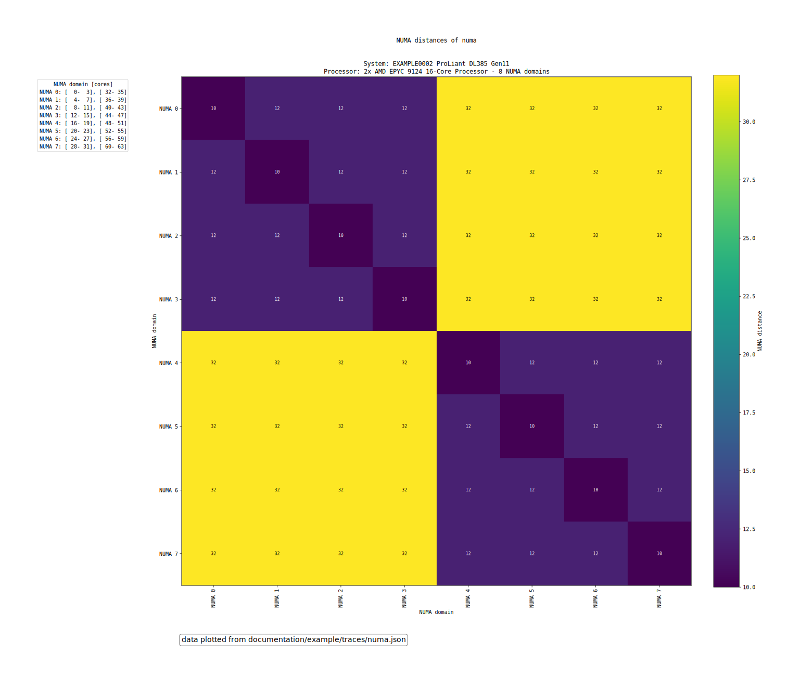

*`NUMA distances.png`: the distance between the NUMA domains of the host, which domains are close to each other, and which are far.*

## Benchmarks summary
`benchmarks_summary.txt` is the key to the benchmark names of the graphs. It starts with the
description of the host, and the NUMA domains with their cores when the trace has the topology,
then one row per benchmark, in the order they ran. From the [reference dataset](example/README.md):

```
Benchmarks summary - numa


System    : EXAMPLE0002 ProLiant DL385 Gen11
Bios      : v3.16
Kernel    : 6.18.52-611.el8.x86_64
Processor : 2x AMD EPYC 9124 16-Core Processor - 32 physical cores and 8 NUMA domains

NUMA nodes (8):
  NUMA 0 : [  0-  3], [ 32- 35]
  NUMA 1 : [  4-  7], [ 36- 39]
  …

Benchmark  Job  Engine / module  Variant  Workers  Pinned cores          NUMA nodes  Duration (s)
---------  ---  ---------------  -------  -------  --------------------  ----------  ------------
cpu_0      cpu  stressng / cpu   int128         2  [      0], [     32]        [ 0]           120
cpu_4      cpu  stressng / cpu   int128        10  [  0-  4], [ 32- 36]     [ 0- 1]           120
cpu_17     cpu  stressng / cpu   int128        36  [  0- 17], [ 32- 49]     [ 0- 4]           120
cpu_30     cpu  stressng / cpu   int128        62  [  0- 30], [ 32- 62]     [ 0- 7]           120
```

| Column | Content |
|---|---|
| `Benchmark` | the name of the benchmark, as in the output tree |
| `Job` | the job it was expanded from |
| `Engine / module`, `Variant` | the engine and the module, and the module parameter |
| `Workers` | the number of stressors |
| `Pinned cores` | the cores the benchmark was pinned to, or `no` |
| `NUMA nodes` | the NUMA domains of the pinned cores, `no` without pinning; `-` when the trace has no topology or no domain matches |
| `Duration (s)` | the `runtime` of the benchmark |

# Per chassis
Servers of a same chassis share their power supplies and their cooling: the chassis graphs
show the servers together, to see how each one weighs on the chassis.

They are enabled with `--same-chassis`, and automatically when there are several traces and
all of them report the same chassis serial number (`environment: All traces are from the same
chassis (<serial>), enabling --same-chassis feature`). The traces must be different servers,
each with a `BMC.Chassis` and a `BMC.Server` power metric, otherwise hwgraph explains why
they are not rendered, like `environment: server are not unique, disabling same-chassis print`.

For each benchmark, `environment/by_chassis/chassis/` contains:

| Graph | What it plots |
|---|---|
| `time_watt_<benchmark> <workers>x<engine>_<module>_<parameter>_chassis_by_Server` | the power of the chassis, of its power supplies, of the sum of the servers and of each server, from the `Server` metric |
| `time_watt_…_chassis_by_ServerInChassis` | the same, from the `ServerInChassis` metric; only when the BMC reports it |

# Per group
`--same-group` plots a group of servers, like the machines of a same rack, together. Every
trace must have the `BMC.Server` and the `CPU.package` power metrics, otherwise hwgraph stops with
`group: missing '<metric>' monitoric metric in <file>`.

The graphs add up the samples of the traces by their position: the first sample of every server with
the first sample of the others, and so on. The servers must therefore run the benchmark at the same
time, which is what [`sync_start`](configuration.md#sync_start)`=time` is made for, and with the same
number of samples: a server that misses one prints `Warning: <trace>/<benchmark>: Missing sample <n>,
considering 0 watts.`

For each benchmark, `by_group/` contains:

| Graph | What it plots |
|---|---|
| `time_watt_<benchmark> …_by_servers` | the power of each server, `BMC.Server` |
| `time_watt_<benchmark> …_by_group` | the sum of the servers: of `BMC.Server`, of `CPU.package`, and the difference between both, what the processors do not account for |
| `time_watt_percent_<benchmark> …_by_group` | the share of the CPU packages, and of the rest of the servers, in percent of the sum of `BMC.Server` |

For example, a group of four servers of the [reference dataset](example/README.md), which ran the
same benchmark at the same time while the cooling distribution unit was rebooted, with
the [event](hwgraph.md#events) `cdu_reboot:80:100`:

```bash
uv run hwgraph graph --same-group --no-env --no-scaling --no-versus --events cdu_reboot:80:100 \
    --traces documentation/example/traces/cdu_reboot.json:server-1:BMC.Server \
             documentation/example/traces/cdu_reboot_2.json:server-2:BMC.Server \
             documentation/example/traces/cdu_reboot_3.json:server-3:BMC.Server \
             documentation/example/traces/cdu_reboot_4.json:server-4:BMC.Server \
    --outdir graphs
```

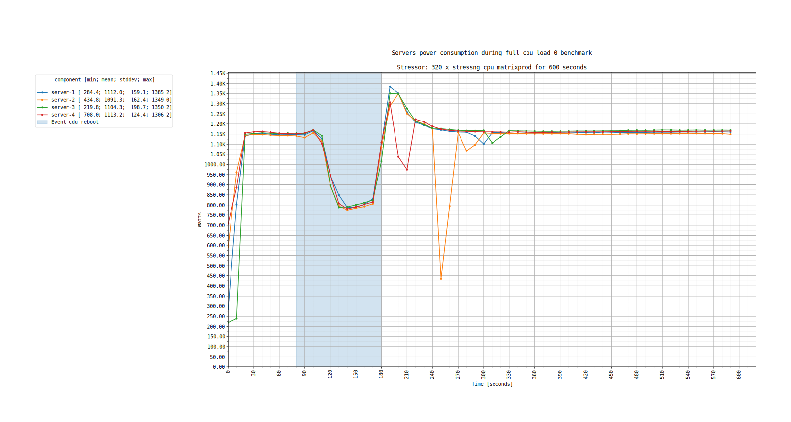

*`by_group/time_watt_… _by_servers.png`: the power of each of the four servers.*

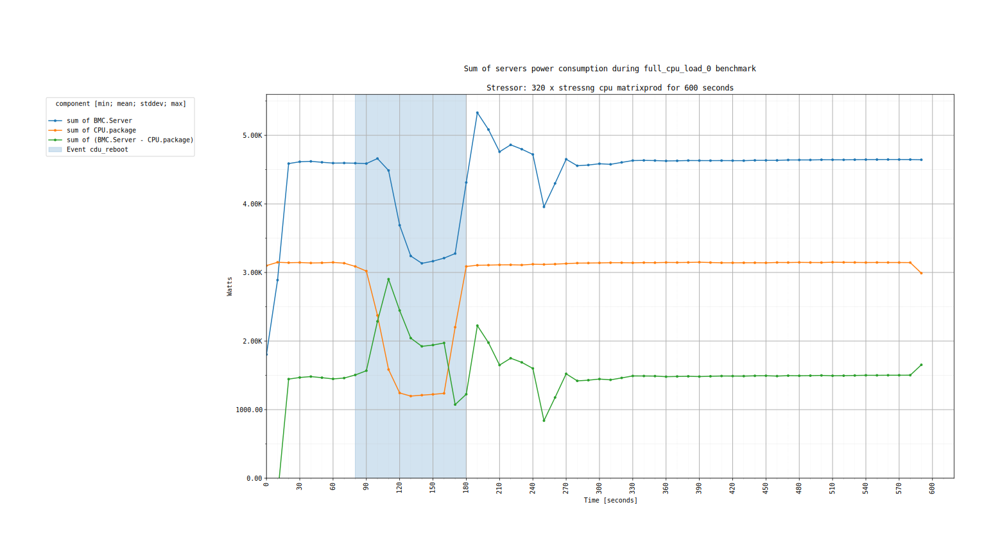

*`by_group/time_watt_… _by_group.png`: the sum of the four servers. The processors slow down during the event, and the power of the group falls from about 4.6 kW to 3.1 kW, while the rest of the servers, the green line, increases during the event.*

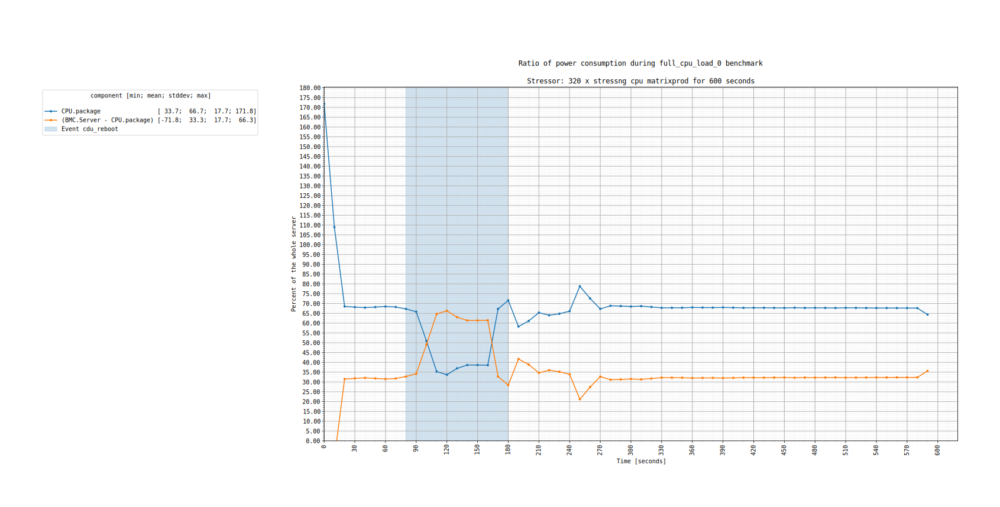

*`by_group/time_watt_percent_… _by_group.png`: what the CPU packages, and the rest of the servers, represent in percent of the power of the group: about 68% and 32% of the power, and about 35% and 65% during the event. The first sample is above 100%: at the beginning of the benchmark, the power reported by the BMC is lower than the one of the CPU packages.*
