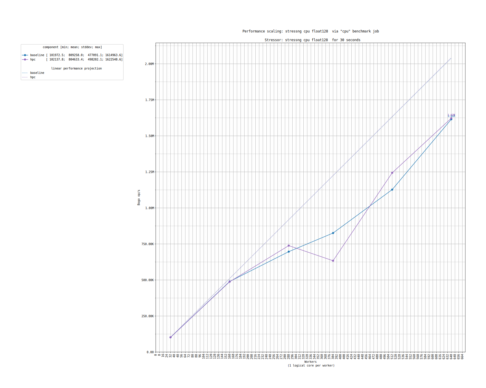
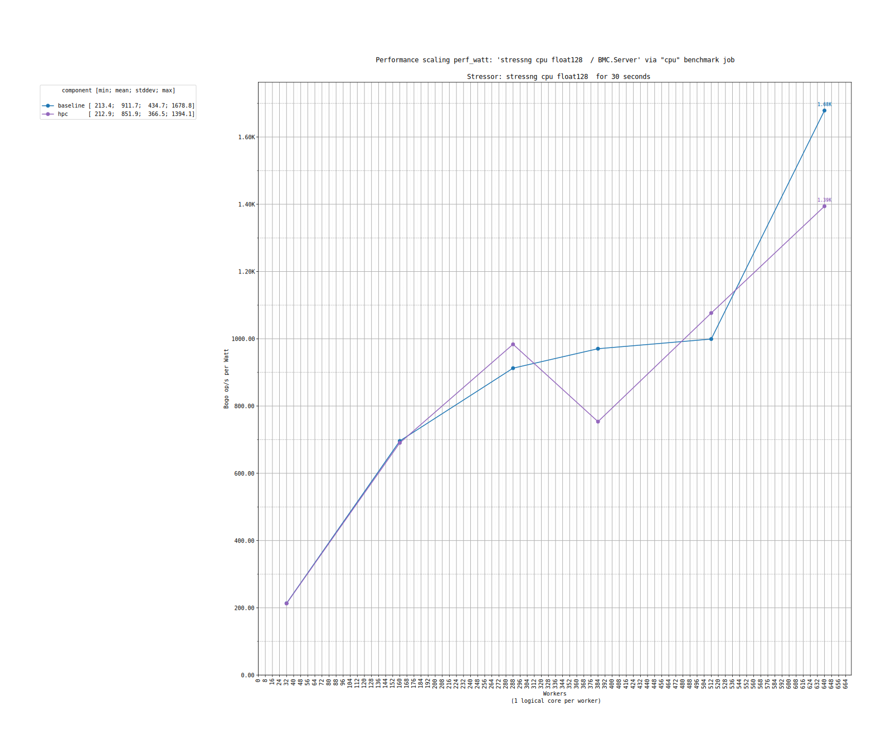
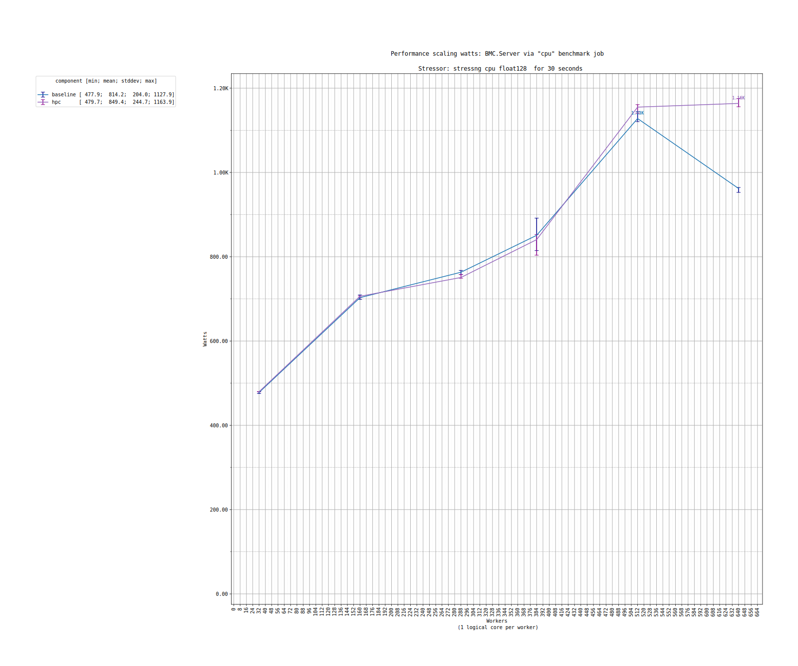
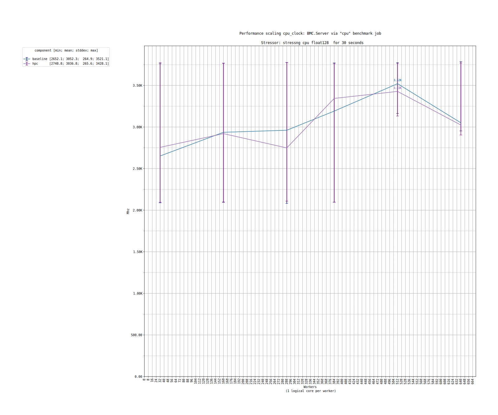
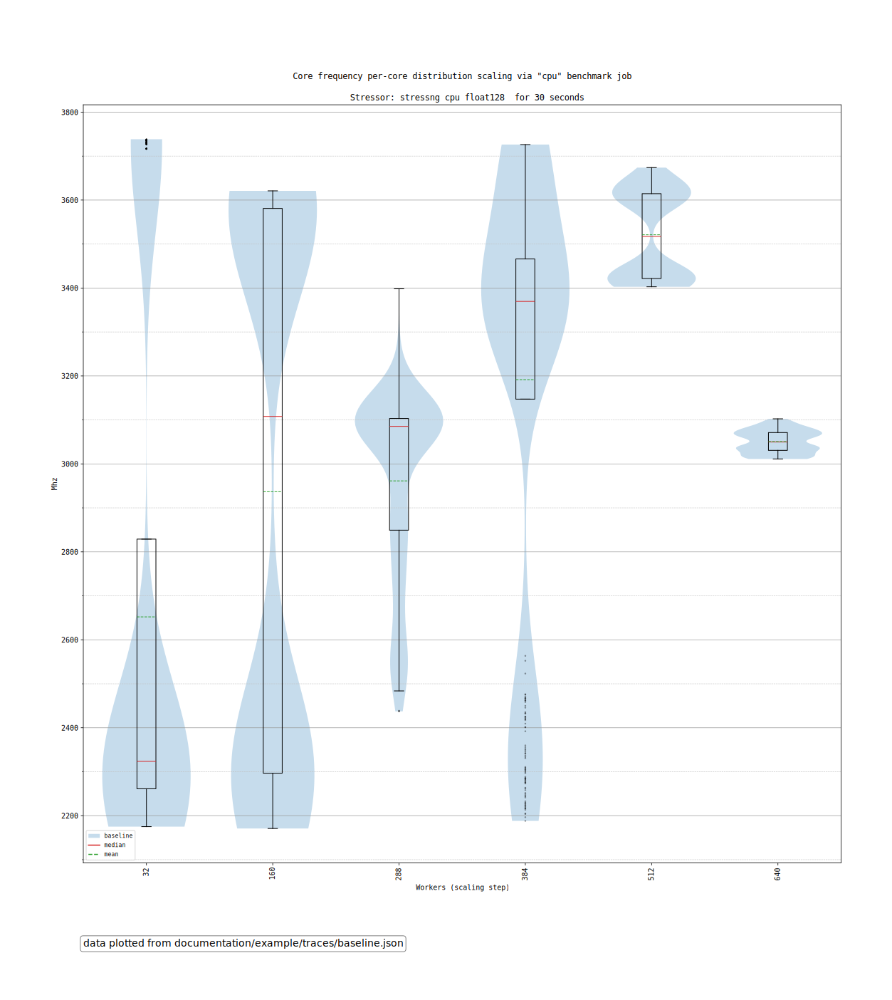
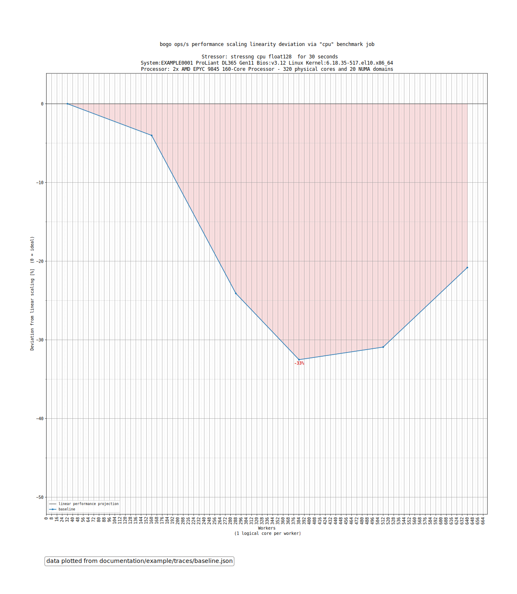
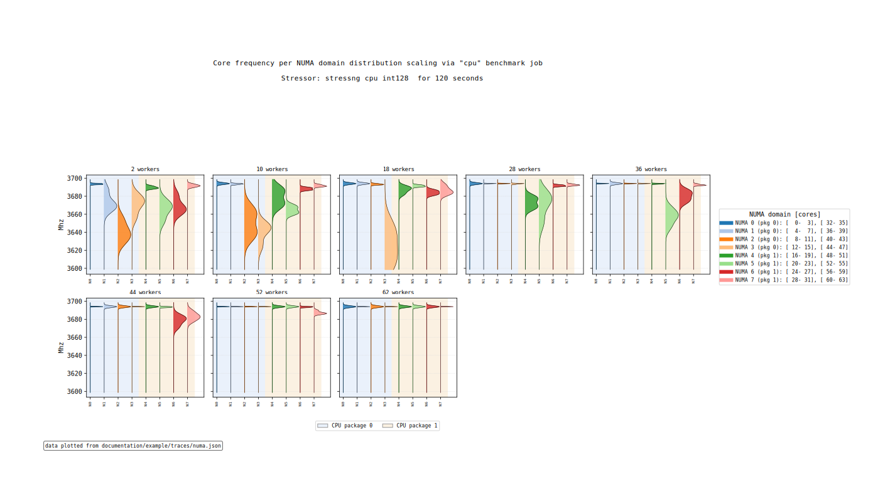

# hwgraph scaling graphs: the performance along the scaling steps

The scaling graphs show how a job behaves when the number of workers grows: one point per
scaling step, for every trace. They are rendered with the performance and the monitoring
metrics of the traces, unless `--no-scaling` is given.

- [Scope](#scope)
- [Scaling](#scaling)

Related pages: [hwgraph.md](hwgraph.md) (the command line, the traces and the output tree),
[configuration.md](configuration.md) ([`stressor_range_scaling`](configuration.md#stressor_range_scaling) and
[`selected_cpus_scaling`](configuration.md#selected_cpus_scaling), which define the steps),
[hwgraph-versus.md](hwgraph-versus.md) (the comparison of the best runs),
[hwgraph-environment.md](hwgraph-environment.md) (the graphs of each benchmark).

# Scope
The performance graphs are grouped by **job**, not by benchmark: all the benchmarks expanded
from the same job, with the same `engine_module_parameter`, are one series, whatever their number.

> ℹ️ **Info**
>
> The performance of a benchmark is read for the `stressng` and `sleep` engines only, as
> `bogo ops/s` for `cpu`, `qsort` and `vnni`, the `write<size>` and `read<size>` of `memrate`
> and `sum_total`, `sum_write` and `sum_read` of `stream`. With another engine, like `fio`,
> hwgraph stops with `Fatal: Unsupported <engine> engine` when it gets to the performance graphs:
> use `--no-scaling --no-versus` to only get the [environment graphs](hwgraph-environment.md).

# Scaling
The scaling graphs show how a job behaves when the number of workers grows, with one point
per scaling step, for every trace, see [`stressor_range_scaling`](configuration.md#stressor_range_scaling)
and [`selected_cpus_scaling`](configuration.md#selected_cpus_scaling). They are written in `scaling/`, and skipped
with `--no-scaling`, or for a job with a single benchmark (`No scaling detected on job
'<job>', skipping graph`).

| Directory | Y axis | Notes |
|---|---|---|
| `perf` | the performance of the engine | dotted lines show the linear performance projection of each trace, when there are more than 3 steps |
| `perf_watt` | the performance per Watt of the `power_metric` | |
| `watts` | the power of the `power_metric`, with min and max | |
| `cpu_clock` | the mean frequency of the cores, with min and max | `all_cores` and `pinned_cores` |
| `cpu_ipc` | the mean IPC of the cores, with min and max | `all_cores` and `pinned_cores`; only when the trace collected the IPC |

The graphs of this page are rendered from the [reference dataset](example/README.md): the `cpu` job (`float128`) of two configurations of the same server, `baseline` and `hpc`, scaled from 32 to 640 workers.

*`perf/scaling_bogoopss_stressng_cpu_float128_.png`: the performance of both traces, with the dotted linear performance projection of each.*

*`perf_watt/…`: the performance per Watt of `BMC.Server`.*

*`watts/…`: the power of `BMC.Server`, with the minimum and the maximum of each step.*

*`cpu_clock/all_cores/…`: the mean frequency of the cores.*

The **linear performance projection** is the line the performance would follow if every added
worker kept the throughput of the first step: the gap to the measured line is the scaling loss.

The line graphs need a different number of workers at each step. A sweep that keeps the same
worker count, like a core by core iteration, only gets the distributions below, with the message
`does not scale job '<job>' on the workers axis`.

Where the line graphs show one value per step, these show what the average hides. The
`distribution` graphs are **violin plots**: one violin per scaling step shows the **distribution of the
individual results**, one per core (its mean over the benchmark), or one per stressor for
`per_worker_distribution`. The width of a violin is the number of results around a value, and the box
inside gives the median (red line), the mean (green dashed line), the quartiles and the outliers. See
[Reading a violin](hwgraph-environment.md#reading-a-violin).

| Graph | Directory | What it plots |
|---|---|---|
| `scaling_<metric>_distribution_<trace>_…` | `cpu_clock`, `cpu_ipc`, `cpu_core_power`, in `all_cores` and `pinned_cores` | the distribution of the cores: cores that start to throttle past a given number of workers |
| `scaling_<metric>_numa_ridgeline_<trace>_…` | the same, in `all_numa` and `pinned_numa` | for each step, one density per NUMA domain |
| `scaling_<metric>_numa_delta_<reference>_vs_<trace>_…` | `cpu_clock`, `cpu_ipc`, in `all_cores` and `pinned_cores` | with at least 2 traces, one heatmap per trace compared to the reference: the NUMA domains over the scaling steps, colored by the difference of the metric; red when the other trace is lower than the reference, green when it is higher, white when there is no difference |
| `perf/linearity_deviation/…` | `perf` | for each trace, how far the performance is from the linear projection: 0% is linear, negative a scaling loss, positive superlinear; only with more than 3 steps |
| `perf/per_worker_distribution/…` | `perf` | the distribution of the individual results of the stressors, when stress-ng gives them |

The NUMA graphs need the NUMA topology in the traces.

*`cpu_clock/all_cores/scaling_cpu_clock_distribution_baseline_…`: the distribution of the frequency of the cores at each step.*

*`perf/linearity_deviation/…`: the deviation from the linear projection, the worst step being annotated.*

The **0 line is the ideal linear performance**, the reference: the performance the job would reach if every added worker
kept the throughput of the first step, which is why the first step is always at 0. The curve is the
**distance between the real performance and this ideal**, in percent, `(measured / ideal - 1) * 100`:
at -33%, the job runs at 67% of the ideal performance. Below 0 is a scaling loss, filled in red; above 0 is a
superlinear step, filled in green. The worst step is annotated.

The ridgelines below come from another trace of the reference dataset, with the NUMA topology: the `cpu` job (`int128`) of a server with 8 NUMA domains, scaled from 2 to 62 workers.

*`cpu_clock/all_numa/scaling_cpu_clock_numa_ridgeline_…`: one panel per step, one density of the core frequencies per NUMA domain.*

Each panel is one scaling step, and shows the **distribution of the cores of each NUMA domain**,
one density per domain: its shape tells whether the cores of a domain behave alike, or split into groups. The colored
background is the **CPU package** the domains belong to, named in the legend below the panels:
the domains of a same package are on the same background. The domains are identified by
the colors of the legend, which also lists their cores.
