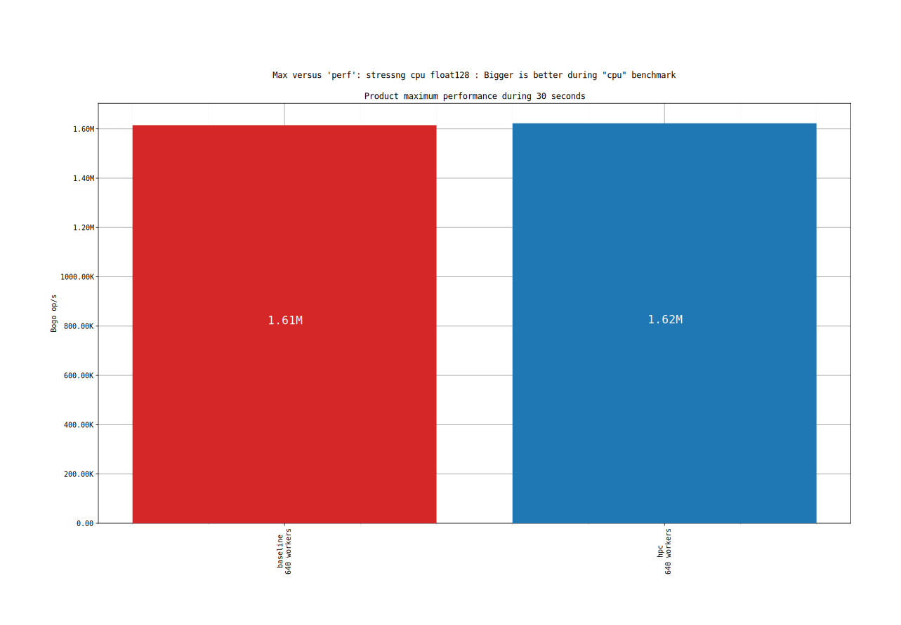
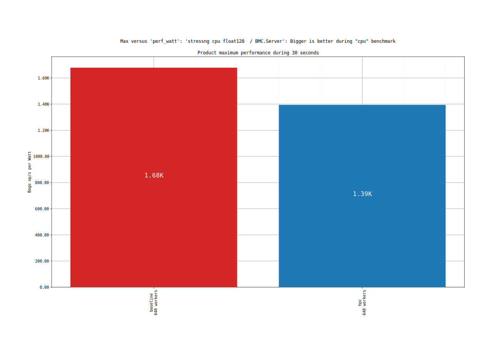
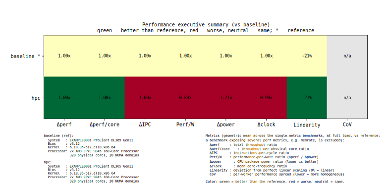

# hwgraph max versus graphs: comparing the traces

The max versus graphs compare the traces on their best run, and the comparison reports
express every trace relative to the first one, the reference. They need at least two traces
and are skipped with `--no-versus`.

- [Max versus](#max-versus)
- [Traces comparison reports](#traces-comparison-reports)
- [CoV: homogeneity of the workers](#cov-homogeneity-of-the-workers)

Related pages: [hwgraph.md](hwgraph.md) (the command line, the traces and the output tree, and the
[`power_metric`](hwgraph.md#power_metric) of the power columns), [hwgraph-scaling.md](hwgraph-scaling.md)
(the performance along the scaling steps, and the same job grouping and supported engines),
[hwgraph-environment.md](hwgraph-environment.md) (the graphs of each benchmark).

# Max versus
`max_versus/` compares the traces on the best run of each: for each trace, the benchmark with
the best performance, and the number of workers it needed, which is written under its name. It needs at least two
traces, otherwise hwgraph prints `Max versus: skipped as at least 2 traces are necessary for this mode`.
The files are in `max_versus/<kind>/<engine_module_parameter>/`, with the metric
inserted when the module has several:

| Kind | Graph | What it plots |
|---|---|---|
| `perf` | `max_perf_total_…`, `max_perf_per_core_…` | the best performance, in total and per physical core of the machine; bigger is better |
| `perf_watt` | `max_perf_total_…`, `max_perf_per_core_…` | the performance per Watt of that run; bigger is better |
| `watts` | `max_perf_total_…`, `max_perf_per_core_…` | the power of that run; lower is better |
| `cpu_clock` | `max_perf_total_…` | the frequency of the pinned cores during that run |

A benchmark that was skipped is labelled `benchmark skipped`.

The graphs of this page are rendered from the [reference dataset](example/README.md): the `cpu` job (`float128`) of two configurations of the same server, `baseline` and `hpc`.



*`perf/float128/max_perf_total_…`: the best performance of each trace, with the number of workers needed.*



*`perf_watt/float128/max_perf_total_…`: the performance per Watt reached by that run.*

# Traces comparison reports
With at least two traces, hwgraph also writes the comparison of each trace to the reference,
in text, and as a scorecard.

| File | Content |
|---|---|
| `max_versus/benchmarks_summary.txt` | the comparison at **full load**: the largest number of workers each trace scaled to |
| `scaling/summary/benchmarks_summary_<NNN>_workers.txt` | the same comparison, for each scaling step, the worker count padded to 3 digits |
| `max_versus/performance_summary_scorecard.<format>` | the **executive summary**: a heatmap with one row per trace and a column per aggregate metric |

The reports have one section per job and parameter, `### cpu/float128  [Bogo op/s]`, with a row per trace, `*` marking the reference:

```
Trace      Wrk     Perf  Δperf  Perf/core  Δperf/core  Power  Δpower  Perf/W  Clock  Δclock   IPC   ΔIPC  CoV  Linearity
---------  ---  -------  -----  ---------  ----------  -----  ------  ------  -----  ------  ----  -----  ---  ---------
baseline*  640    1.61M  1.00x      5.05K       1.00x   962W   1.00x   1.00x  3051M   1.00x  1.81  1.00x    -       -21%
hpc        640    1.62M  1.00x      5.07K       1.00x  1164W   1.21x   0.83x  3024M   0.99x  1.80  1.00x    -       -21%
```

Here, `hpc` reaches the same performance as the reference (`Δperf` 1.00x) while drawing 21% more
power (`Δpower` 1.21x): its performance per Watt is 0.83x the reference (`1.00 / 1.21`).

| Column | Content |
|---|---|
| `Wrk` | the number of workers |
| `Perf`, `Δperf` | the performance, and its ratio to the reference |
| `Perf/core`, `Δperf/core` | the performance per physical core (not per thread or worker), and its ratio |
| `Power`, `Δpower` | the mean power of the `power_metric`, and its ratio |
| `Perf/W` | the performance per Watt, as a ratio to the reference: `Δperf / Δpower` |
| `Clock`, `Δclock` | the mean frequency of the cores, and its ratio |
| `IPC`, `ΔIPC` | the mean IPC of the cores, and its ratio; only when a trace collected it |
| [`CoV`](#cov-homogeneity-of-the-workers) | the coefficient of variation, in percent, of the performance of the workers: how evenly they performed; `-` when there is no per-worker detail |
| `Linearity` | the deviation from a perfect linear scaling, `(perf / linear projection) - 100%` |

The `Aggregate` section at the end gives, in a single row per trace, the geometric mean of the
full-load ratios of the benchmarks that have a single performance metric. A benchmark that
exposes several, like `memrate`, would outweigh the others, so it is left out, and the section
names it (`Excluded: memrate/memrate`).

The scorecard colors the same aggregate: green is better than the reference, red is worse,
where lower is better for the power and the CoV.



*`performance_summary_scorecard.png`: one row per trace, one column per aggregate metric, with the description of each system below.*

> ℹ️ **Info**
>
> The colors of a column are scaled to the largest difference of that column, so a small
> difference can be as colored as a large one: read the values, not only the colors. In the
> scorecard above, `ΔIPC` is 1.00x for both traces, and still colored.

> 💡 **Good practice**
>
> Put the trace you trust as the **first** one: it is the reference of every ratio. For a
> before and after, the reference is the "before".

# CoV: homogeneity of the workers
`Perf` is the sum of what all the workers did, so it hides how evenly the work was shared.
The **coefficient of variation** (CoV) measures that spread: the standard deviation of the
performance of the individual workers, divided by their mean, in percent. Each worker is a
stressor instance, and stress-ng reports the `bogo op/s` of each one.

| CoV | Meaning |
|---|---|
| 0% | all the workers performed the same |
| low, like 1% | homogeneous: the workers ran at the same speed |
| high, like 20% | some workers were much slower or faster than the others |

Two runs can reach the same `Perf` with a different CoV: a high CoV points at workers that
did not get the same resources, like cores running at different frequencies, a throttled
core, a worker sharing a core with another, or workers spread over NUMA domains of
different performance. The [scaling distributions](hwgraph-scaling.md) and the
`perf/per_worker_distribution` graphs show where the spread comes from.

Lower is better, so the scorecard colors a lower CoV in green.

The CoV is `-` when the benchmark has no per-worker `bogo op/s` of at least 2 workers: an
engine that does not report them, a skipped benchmark, or a result written without them. In
the `Aggregate` section, it is the mean of the CoV of the benchmarks that have one.
