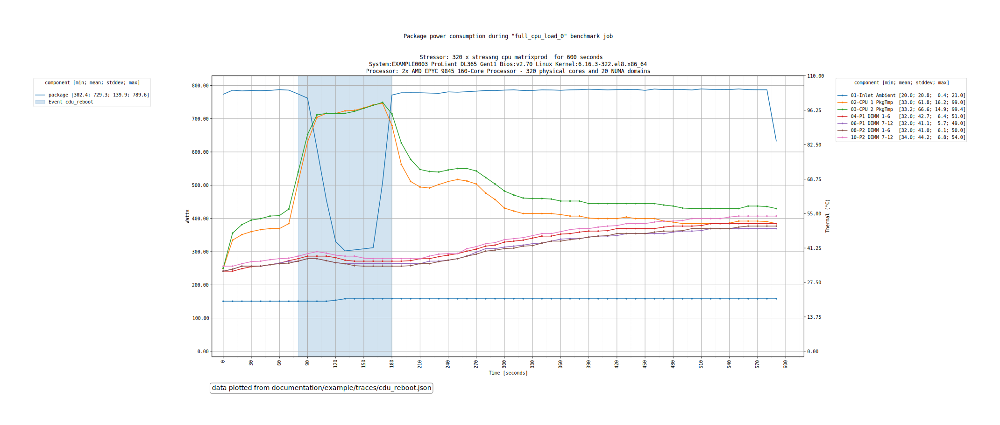
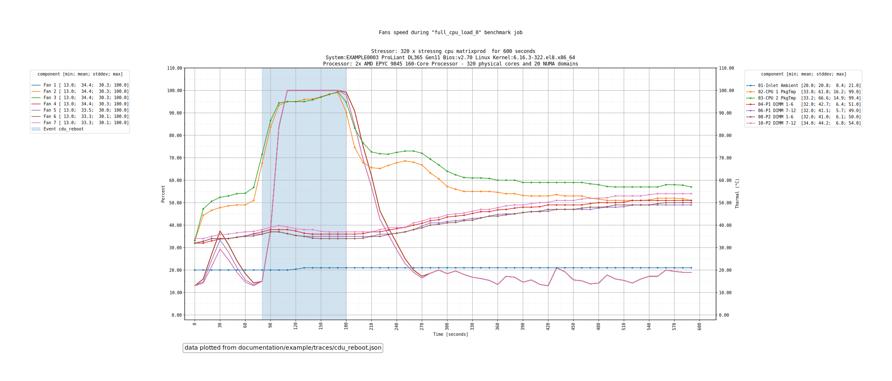

# hwgraph: plotting and comparing results

hwgraph reads the `results.json` files written by hwbench. From a single file it plots how
the target machine behaved during each benchmark; from several files it compares the
machines, or the runs of a same machine, with graphs and text reports.

- [Concept](#concept)
- [Installation](#installation)
- [Usage](#usage)
  - [Listing the power metrics: `list`](#listing-the-power-metrics-list)
  - [Rendering the graphs: `graph`](#rendering-the-graphs-graph)
- [Trace files](#trace-files)
  - [logical_name](#logical_name)
  - [power_metric](#power_metric)
  - [Comparing traces](#comparing-traces)
- [Options](#options)
- [Output tree](#output-tree)
- [Graphs](#graphs)
- [Missing data points](#missing-data-points)
- [Implementation notes](#implementation-notes)

Related pages: [hwgraph-environment.md](hwgraph-environment.md), [hwgraph-scaling.md](hwgraph-scaling.md) and
[hwgraph-versus.md](hwgraph-versus.md) (the graphs), [concepts.md](concepts.md) (the job and the intention that make runs
comparable), [monitoring.md](monitoring.md) (where the environment metrics come from),
[stressng.md](stressng.md) (the engine whose performance hwgraph plots),
[cpu-selection.md](cpu-selection.md) (the pinned cores that hwgraph reports).

# Concept
hwgraph works on **traces**: a trace is a `results.json` file, given a name and the power
metric to use for the "watts" and "performance per watt" graphs. It never runs a benchmark
and needs no root access.

Because it only reads files, hwgraph is meant to **stay compatible over time**: as it
evolves, the traces recorded earlier can be graphed again, and benefit from the new graphs.
Keep the `results.json` of your runs: they are the reference, the graphs can always be
regenerated from them, and the `cmdline` file written in the output directory gives the
command line to do it again. What a trace does not contain is skipped, not an error:

| Older trace | What hwgraph does |
|---|---|
| monitoring in the legacy layout, without `contexts` and `metadata` | reads it as is |
| no NUMA topology | skips the NUMA graphs: `no NUMA metric present in trace file, skipping` |
| no IPC metric | skips the IPC graphs and columns |
| no per-worker detail from stress-ng | skips the per-worker distributions, and shows `-` as the CoV |
| no memory power `CPU.Ram`, or missing some of its samples | graphs without it, silently: the memory power is optional |

> ℹ️ **Info**
>
> The goal is compatibility, not a guarantee: a trace that misses a metric hwgraph needs, like
> the power consumption, stops it with the error explaining what is missing.

Two families of graphs come out of the traces:

| Family | Question it answers | Needs |
|---|---|---|
| [environment](hwgraph-environment.md) | how did the power, the frequencies, the IPC, the fans and the temperatures behave **during** each benchmark? | the monitoring metrics of the trace |
| [performance](hwgraph-scaling.md) | how does the performance **scale** with the number of workers, and how do the traces compare? | a job run with several benchmarks, for the scaling; at least 2 traces, for the comparisons |

> ℹ️ **Info**
>
> The monitoring metrics are mandatory: `hwbench` must have been run with
> [`monitor=all`](monitoring.md#usage), and the trace needs power consumption metrics. A trace
> without them stops hwgraph with `Cannot find monitoring metrics` or
> `Cannot find power consumption metrics`.

# Installation
hwgraph needs the plotting dependencies, which are not installed by default:

```bash
uv sync --extra graph
```

Without them, `uv run hwgraph` prints the import error and
``Could not start hwgraph: did you make sure to also install the "graph" optional dependencies using `uv sync --extra graph` or `pip install hwbench[graph]`?``, then exits with
the status 1. The Cairo and Python headers listed in the README are needed to build them.

# Usage
hwgraph has two sub-commands:

| Sub-command | Effect |
|---|---|
| `graph` | renders the graphs and the reports of one or several traces |
| `list` | lists the power metrics of a trace |

Without any argument, `uv run hwgraph` prints its help.

## Listing the power metrics: `list`
The [`power_metric`](#power_metric) of a trace must be one of the power consumption metrics
of its monitoring: `list` prints them.

```bash
uv run hwgraph list --trace documentation/example/traces/numa.json
```

```
List of power metrics:
CPU.package
CPU.Core_0
CPU.Core_1
…
CPU.Core_31
BMC.Server
```

The names are the component followed by the measure: `CPU.package` is the power of the
processor package reported by turbostat, `CPU.Ram` the power of the memory when the
processor meters it, `BMC.Server` the power of the server reported by
its BMC. Which ones exist depends on the target machine and on its
[BMC driver](monitoring.md#bmc): on a server of a multi-node chassis, the BMC also gives
`BMC.ServerInChassis`, `BMC.Infrastructure` and `BMC.Chassis`.

## Rendering the graphs: `graph`
`--traces` and `--outdir` are mandatory:

```bash
uv run hwgraph graph \
    --traces documentation/example/traces/baseline.json:baseline:BMC.Server \
             documentation/example/traces/hpc.json:hpc:BMC.Server \
    --outdir graphs
```

hwgraph starts by checking that the traces can be compared, writes the
[benchmarks summary](hwgraph-environment.md#benchmarks-summary) of each host, then renders the graphs in parallel
and ends with `<n> graphs can be found in '<outdir>' directory`. It also writes the command
line it was run with in `<outdir>/cmdline`, to regenerate the graphs later.

> 💡 **Good practice**
>
> Rendering hundreds of graphs takes a while. Start with `--format png --dpi 40`, a fast
> and light rendering to check the traces, then run again with the default `svg` for the
> final graphs.

# Trace files
Each trace is given with the syntax `<json_filename>:<logical_name>:<power_metric>`; the
three parts are mandatory, even when `logical_name` is empty.

| Part | Value | Effect |
|---|---|---|
| `json_filename` | a path | the `results.json` of hwbench |
| [`logical_name`](#logical_name) | text, or empty | how the trace is named in the graphs and the output tree |
| [`power_metric`](#power_metric) | a `<component>.<measure>` name | the power consumption metric of the "watts" and "performance per watt" graphs |

A value that does not follow this syntax is rejected with
`<value> does not match 'filename:logical_name:power_metric' syntax`, and a file that is not
readable with `<file> is not a valid file` or `<file> is not a valid JSON file`.

## logical_name

| Value | Effect |
|---|---|
| `<name>` | the name of the trace, like `baseline` |
| empty, like `results.json::BMC.Server` | the serial number of the server |
| `CPU` | the model of the processor, with the number of sockets when there are several, like `1 x AMD EPYC 8534P 64-Core`; it must be unique over all the traces |

The name becomes a directory of the [output tree](#output-tree), so keep it short and
without spaces. Two traces with the same name stop hwgraph with
`<file> is using '<name>' as logical_name while it's already in use`.

## power_metric
The name of a power consumption metric, as printed by [`list`](#listing-the-power-metrics-list),
like `CPU.package` or `BMC.Server`. A name hwgraph does not find in the first benchmark of the
trace stops it with `Cannot find <name> in power consumption metrics`, followed by the
names that exist.

**The choice of the metric defines what the power and energy efficiency graphs measure.**
It is the source of every "watts" and "performance per Watt" graph: the `watts` and
`perf_watt` [scaling](hwgraph-scaling.md) and [max versus](hwgraph-versus.md#max-versus) graphs, the `Power` and
`Perf/W` columns of the [comparison reports](hwgraph-versus.md#traces-comparison-reports), and the power
shown in the title of those graphs.

| Value | Scope | Use it to |
|---|---|---|
| `CPU.package` | the processor package only, as reported by turbostat | compare the processors, ignoring the rest of the server |
| `BMC.Server` | the whole server, as reported by its BMC: the processors, but also the fans, the memory, the storage, the network, etc. | study the energy efficiency of the server as a whole |

The same performance gives a different efficiency with each metric, so the metric must
follow the question of the study.

> 💡 **Good practice**
>
> Use the same `power_metric` for all the traces. The comparisons are only meaningful when
> the watts come from the same sensor: the [traces comparison](hwgraph-versus.md#traces-comparison-reports)
> names the metric, and says when it varies across the traces.

## Comparing traces
The first trace is the **reference**: the comparisons are expressed relative to it. To be
compared, the traces must come from the **same job file**: hwgraph compares the `config`
section of each `results.json` to the first one, and stops with
`<file> is not having the same configuration file as previous traces` when they differ.

The number of benchmarks may differ: as explained in [concepts.md](concepts.md), hwgraph
groups the benchmarks by their `job_name`, so a machine with fewer cores, which expanded the
same job into fewer benchmarks, can still be compared.

Only the traces of the same benchmark names can be drawn together in the environment graphs
that overlay the traces ([chassis](hwgraph-environment.md#per-chassis) and [group](hwgraph-environment.md#per-group)): these graphs
read the benchmark of every trace by its name.

# Options

| Option | Value | Effect |
|---|---|---|
| `--traces` | one or several [traces](#trace-files) | mandatory |
| `--outdir` | a directory | mandatory: where the [output tree](#output-tree) is written, created when it does not exist |
| `--no-env` | flag | does not render the [environment graphs](hwgraph-environment.md) |
| `--no-scaling` | flag | does not render the [scaling graphs](hwgraph-scaling.md) |
| `--no-versus` | flag | does not render the [max versus graphs](hwgraph-versus.md#max-versus) and the [comparison reports](hwgraph-versus.md#traces-comparison-reports) |
| `--no-stats` | flag | does not print the statistics, the maximum power seen in the traces |
| `--title` | text, default empty | added in the title of the graphs |
| `--format` | `svg` (default), `png` | the file format of the graphs |
| `--engine` | `cairo` (default), `pgf`, `svg`, `agg` | the matplotlib backend used to draw the graphs |
| `--dpi` | integer, default `72` | the resolution of the graphs |
| `--width`, `--height` | integers, default `1920` and `1080` | the size of the graphs: the figure measures `width/100` by `height/100` inches, so the image is `width/100*dpi` pixels wide |
| `--events` | `<event_name>:<start_time>:<duration>` | [marks periods on the time graphs](#events) |
| `--same-chassis` | flag | all the traces are servers of the same chassis: [chassis graphs](hwgraph-environment.md#per-chassis) |
| `--same-group` | flag | all the traces are a group of servers: [group graphs](hwgraph-environment.md#per-group) |
| `--ignore-missing-datapoint` | `zero`, `last`, default not set | [replaces the missing data points](#missing-data-points) instead of stopping |
| `--jobs`, `-j` | integer, default half the CPUs of the host | the number of worker processes rendering the graphs; with 1, the graphs are rendered one after the other |
| `--verbose` | flag | prints more information, like the metrics without samples that are skipped |

> ℹ️ **Info**
>
> The `--no-*` flags only disable what they name: the default is to render everything that
> the traces allow. The help of the sub-command says, for instance, `Disable 'max versus' graphs`.

## Events
`--events` marks on the time graphs what happened to the target machine during the
benchmark, like a fan failure or a cooling change. Each event is `<event_name>:<start_time>:<duration>`
with the start and the duration in seconds: it is drawn as a colored band, named
`Event <event_name>` in the legend. `event_name` cannot be empty, `start_time` cannot be
negative and `duration` must be greater than 0. Several events can be given; they get a different color each.

The start is read on the time axis of the graphs, whose 0 is the beginning of the monitoring of the benchmark:
hwgraph does not know when the event really happened, you tell it. The same events are drawn on the
graph of every benchmark, so they fit best a trace made of a single long benchmark.

For example, a cooling distribution unit (CDU) was rebooted for 100 seconds, 80 seconds after the
beginning of a 600 seconds benchmark of the [reference dataset](example/README.md):

```bash
uv run hwgraph graph \
    --traces documentation/example/traces/cdu_reboot.json:cdu_reboot:BMC.Server \
    --events cdu_reboot:80:100 \
    --outdir graphs
```



*`PowerConsumption/Package power consumption_vs_Thermal.png`: the blue band is the event. During it, the temperature of the CPUs climbs to 99°C, and the power of the CPU packages falls from about 780 Watts to 300 Watts, as the processors slow down.*



*`Fans/Fans speed_vs_Thermal.png`: the fans react to the temperature of the CPUs by going to their maximum speed.*

> ℹ️ **Info**
>
> The events are drawn on every graph with a standard legend, so also on the scaling graphs
> like `watts` or `cpu_clock`, where the X axis is the number of workers, not seconds: the band
> is meaningless there. Use `--no-scaling` when giving `--events`. The bar graphs of
> [max versus](hwgraph-versus.md) have no event.

# Output tree
Everything is written under `--outdir`:

```
<outdir>/
├── cmdline                       the command line of this rendering
├── environment/
│   ├── by_host/
│   │   └── <logical_name>/
│   │       ├── benchmarks_summary.txt
│   │       ├── NUMA distances.<format>
│   │       └── <benchmark>/<metric>/…
│   └── by_chassis/chassis/       with --same-chassis, or all the traces of a same chassis
├── by_group/                     with --same-group
├── scaling/                      performance of a job along its scaling steps
│   ├── perf/ perf_watt/ watts/ cpu_clock/ cpu_ipc/ cpu_core_power/
│   └── summary/
└── max_versus/                   needs at least 2 traces
    ├── perf/ perf_watt/ watts/ cpu_clock/
    ├── benchmarks_summary.txt
    └── performance_summary_scorecard.<format>
```

# Graphs
hwgraph renders three kinds of graphs, each described in its own page:

| Page | Graphs | Option to disable | Needs |
|---|---|---|---|
| [hwgraph-environment.md](hwgraph-environment.md) | the monitoring metrics **during** each benchmark: per host, per chassis, per group | `--no-env` | the monitoring metrics of the trace |
| [hwgraph-scaling.md](hwgraph-scaling.md) | the performance along the scaling steps of a job | `--no-scaling` | a job run with several benchmarks |
| [hwgraph-versus.md](hwgraph-versus.md) | the best run of each trace, and the comparison reports | `--no-versus` | at least 2 traces |

The images of these pages are rendered from a [reference dataset](example/README.md), real traces reduced and anonymized, with a script to regenerate them.

# Missing data points
The monitoring may miss a sample, for instance when a sensor did not answer in time.
When a metric has fewer samples than the benchmark, hwgraph stops:

```
Fatal: <trace>/<benchmark>: <metric> is missing the 4th data point. Use --ignore-missing-datapoint to ignore this case. Generated graphs will be partially incorrect.
```

| Value | Effect |
|---|---|
| not set (default) | stops at the first missing data point |
| `zero` | replaces the missing data point by 0 |
| `last` | replaces it by the last known value |

> ℹ️ **Info**
>
> The graphs with a replaced value are partially incorrect. A `zero` shows as a
> drop to 0 on the graph.

# Implementation notes
- **Entry point**: `graph/hwgraph.py:main()`; `render_traces()` runs the `graph`
  sub-command: `compare_traces()` checks the traces, `generate_stats()` prints the maximum
  power, `write_benchmarks_summary()` writes the summaries, and `_collect_group_tasks()`,
  `_collect_environment_tasks()` and `_collect_plot_tasks()` build the list of tasks.
- **Parallelism**: `_execute_tasks()` runs the tasks in a `ProcessPoolExecutor` of
  `--jobs` workers, or sequentially with 1. The arguments are pickled once and given to each
  worker by `_init_pool_worker()`. A task that raises an exception prints `Error generating graph`
  and the others go on; a `fatal()` (`Fatal: …`) stops hwgraph with the status 1.
- **Traces**: `graph/trace.py`. `Trace` loads a `results.json` and checks its power
  metric (`validate()`); `Bench` is one benchmark with its monitoring metrics
  (`load_monitoring()`) and `add_perf()` extracts the performance, the power, the clock and the IPC
  of a benchmark. `Event` holds `--events`.
- **Graphs**: `graph/graph.py`. `Graph` wraps a matplotlib figure and its legend;
  `generic_graph()` and `yerr_graph()` draw the time graphs, `numa_*` the NUMA ones.
- **Environment**: `graph/chassis.py` (`graph_chassis()`) and `graph/group.py`
  (`graph_group_env()`); the per-host graphs are `graph_*()` in `hwgraph.py`.
- **Performance**: `graph/scaling.py` (`performance_scaling_graph()` and the `render_*()`
  functions of the distributions) and `graph/versus.py` (`max_versus_graph()`,
  `write_scaling_comparison()`, `write_scaling_step_comparisons()`,
  `render_versus_scorecard()`).
- **Shared structures**: the metric names (`MonitoringContextKeys`, `PowerCategories`…) come
  from `hwbench/bench/monitoring_structs.py`.
